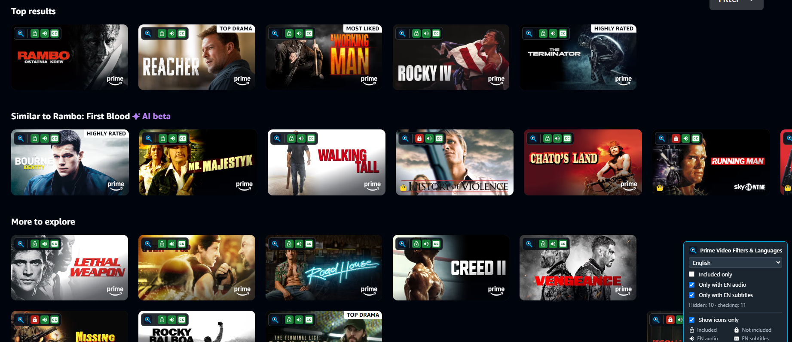
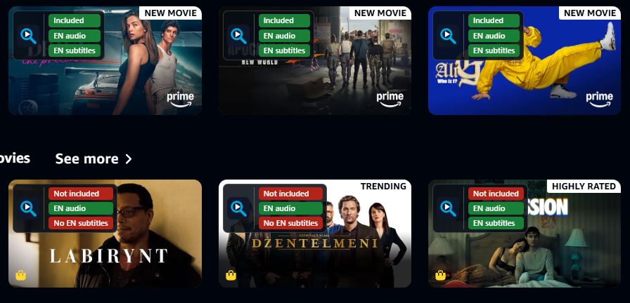
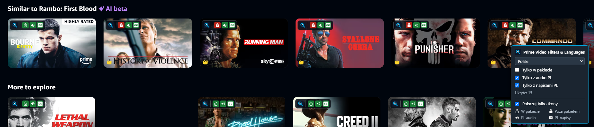
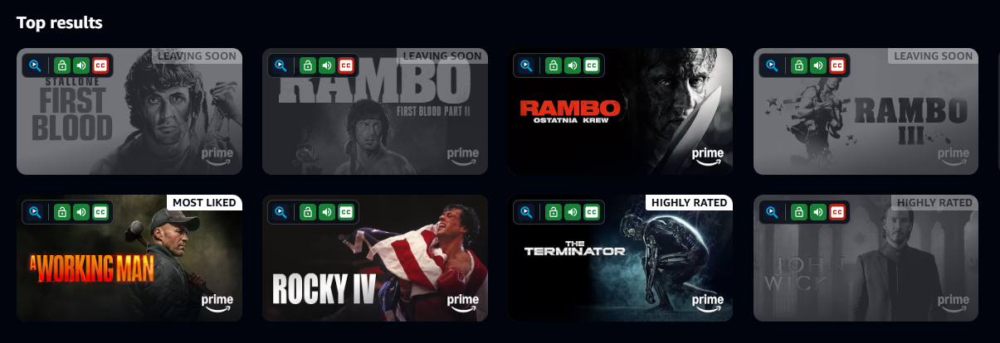
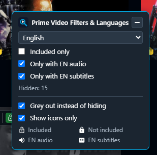
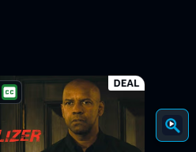
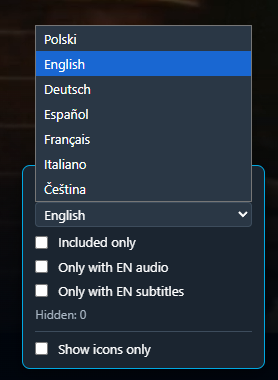
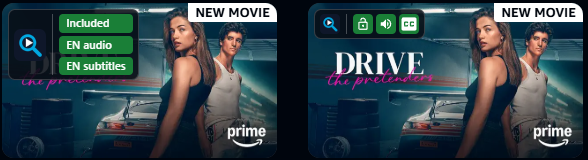
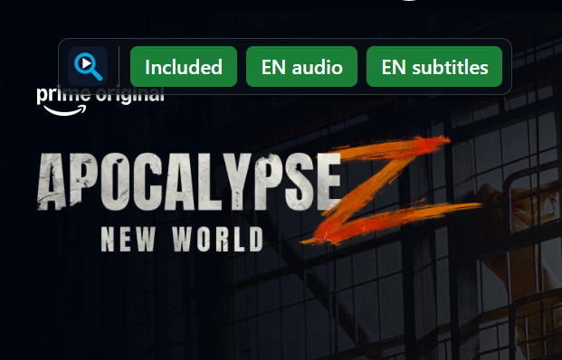
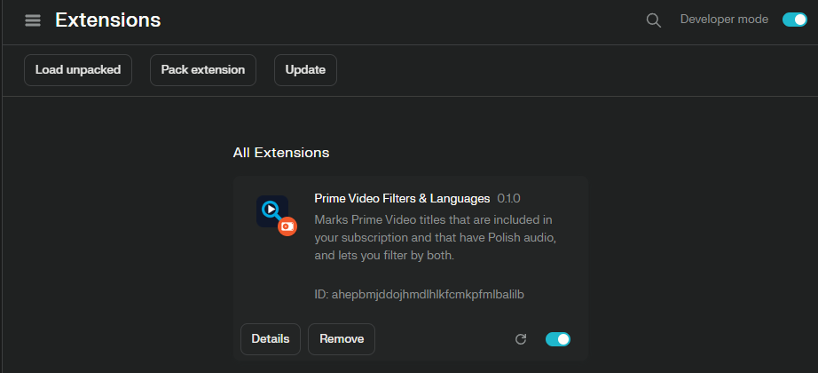

# Prime Video Filters & Languages

**Find out what you can actually watch on Prime Video - before you click.**

Prime Video mixes titles included in your subscription with ones you have to rent or buy, and it hides which audio and subtitle languages a title has until you open its page. This Chrome extension puts that information right on the title cards and lets you filter by it.



## What you get

### Badges on every card

- **In my subscription** or not: no more clicking a title only to find out it costs extra.
- **Audio** in your language (or not): is there a dub or voice-over?
- **Subtitles** in your language (or not).



Works on search results, the home page, Movies, TV, genres, collections, the watchlist and the carousels on title pages. That covers regular cards, the tall posters of the "super carousel" and the rotating banner at the top.

### Filters

A panel in the bottom-right corner hides what you do not want to see: titles outside your subscription, titles without audio and/or without subtitles in your language.



Would you rather keep them in sight? The **"grey out instead of hiding"** switch leaves the non-matching titles in place, grey and faded, with their badges still in colour; hover over one to see it normally.



When the panel is in the way, the **minus button** in its header collapses it to a small icon in the corner; click the icon to bring the panel back. The filters keep working while it is collapsed. While a video is playing, the panel steps aside on its own.

 

### Your language

Pick **EN, PL, DE, ES, FR, IT or CS**. It sets the language looked for in audio and subtitles and the language of the panel and badges. Until you pick one, your browser's language is used if it is on the list, otherwise English.



### Icons-only view

Prefer a calmer page? The **"show icons only"** switch turns every badge into a small coloured square: a padlock for the subscription, a speaker for audio, "CC" for subtitles. Green means yes, red means no, grey means not known yet.



### Details page banner

On a title's own page the same three checks appear as a large banner above the title art.



Your settings (filters, language, grey out, simplified view, collapsed panel) are remembered.

## Installation

1. Open `chrome://extensions` in Chrome.
2. Turn on **Developer mode** (top-right).
3. Click **Load unpacked** and pick this directory.
4. Open (or reload) a Prime Video page.



After changing the code, click the reload icon on the extension's card in `chrome://extensions` and reload the Prime Video tab.

## Releases

Pushing a version tag builds a release: GitHub Actions ([.github/workflows/release.yml](.github/workflows/release.yml)) packs `manifest.json`, `content.js`, `content.css` and `icons/` into a ZIP and attaches it to a GitHub Release. The tag must match `version` in `manifest.json`, otherwise the build fails.

```bash
# after setting "version": "0.2.0" in manifest.json and committing
git tag v0.2.0
git push origin v0.2.0
```

## Good to know

- It relies on Prime Video's undocumented page structure, which can change at any time.
- Audio and subtitle lists are what Prime Video's detail data says, cached for up to 14 days.
- Its only permission is `storage`, used for that cache.

Full list: [docs/HOW_IT_WORKS.md](docs/HOW_IT_WORKS.md#limitations).

## Documentation

- [docs/HOW_IT_WORKS.md](docs/HOW_IT_WORKS.md) - where the data comes from, requests, cache, limitations
- [docs/ANALYSIS.md](docs/ANALYSIS.md) - how the Prime Video pages were analysed
- [docs/PRIME_VIDEO_DATA.md](docs/PRIME_VIDEO_DATA.md) - the page structure and data the extension relies on
- [docs/DECISIONS.md](docs/DECISIONS.md) - design decisions and open questions
